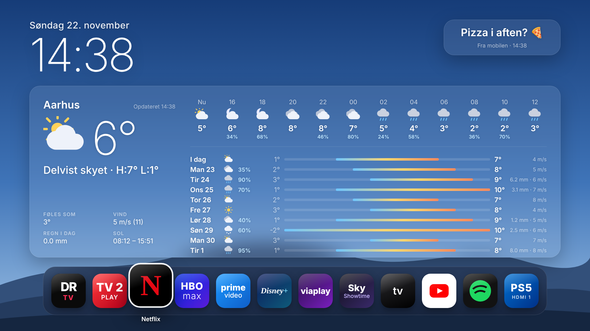
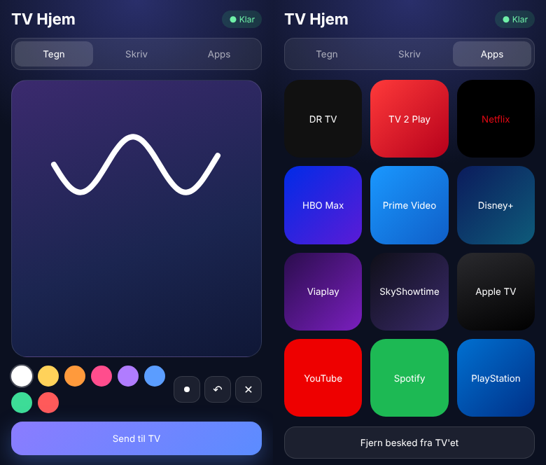

# TV Hjem – egen startskærm til Samsung Q60D





To dele:

| Mappe | Hvad | Hvor kører det |
|---|---|---|
| `tv-app/` | Startskærm med ur, stort vejr for Aarhus (nu, time for time og 10 dage), egne app-ikoner og en beskedtavle | På TV'et (Tizen-app) |
| `mobil/` | Tegn/skriv beskeder til TV'et og åbn apps på TV'et fra mobilen | På mobilen (hjemmeside) |

Mobilen og TV'et snakker sammen via den gratis tjeneste **ntfy.sh** på en hemmelig kanal-nøgle.
Nøglen står **ikke** i dette offentlige repository: skriv den i `tv-app/config.js` (`kanal`),
og åbn mobil-siden med `#k=<nøglen>` sidst i adressen første gang – så husker telefonen den.
Vejret kommer fra **Open-Meteo** (gratis, ingen konto).

---

## 1. Se den på computeren først

Åbn `tv-app/index.html?demo=1` i Chrome – så ser du designet med eksempeldata.
(Uden `?demo=1` henter den rigtigt vejr.)

## 2. Installer på TV'et

**På TV'et (Samsung TQ55Q60DAU):**
1. Find TV'ets IP: *Indstillinger → Generelt → Netværk → Netværksstatus → IP-indstillinger*.
2. Åbn **Apps**, tast **1 2 3 4 5** (skærmtastatur hvis fjernbetjeningen ikke har tal).
3. Sæt **Developer mode = On** og skriv din **computers** IP-adresse. Genstart TV'et (sluk på knappen i 30 sek.).

**På computeren (én gang):**
1. Hent **Tizen Studio** (med IDE): https://developer.tizen.org/development/tizen-studio/download
2. Åbn *Package Manager* → fanen *Extension SDK* → installer **TV Extensions** og **Samsung Certificate Extension**.
3. *Tools → Device Manager* → *Remote Device Manager* → **+** → skriv TV'ets IP → slå *Connection* til.
4. *Tools → Certificate Manager* → **+** → **Samsung** → **TV** → lav et nyt certifikat (log ind med en Samsung-konto).
   Når den spørger efter DUID, er TV'et allerede valgt, fordi det er forbundet. Vælg privilegieniveau **Public**.

**Installer appen:**
1. *File → Import → Tizen → Tizen Project* → vælg mappen `tv-app`
   (eller lav et nyt tomt *Web Application*-projekt til TV og kopier filerne ind).
2. Højreklik på projektet → **Run As → Tizen Web Application**.
3. Appen hedder **"Hjem"** under Apps på TV'et. Flyt den forrest i app-rækken
   (hold OK nede på ikonet → *Flyt*), så den ligger ét tryk væk.

Alternativt fra kommandolinjen:
```bash
sdb connect <TV-IP>
tizen package -t wgt -s <dit-certifikat-navn> -- tv-app
tizen install -n tv-app/Hjem.wgt -t <enhedsnavn fra 'sdb devices'>
```

### Betjening på TV'et
- **← →** vælg app · **OK** åbn · **Tilbage** fjern beskeden fra skærmen.
- Grå ikoner = appen blev ikke fundet på TV'et (installer den fra Samsungs app-butik).

## 3. Mobil-appen (GitHub Pages)

1. Lav et nyt repository på GitHub, f.eks. `tv-hjem`, og upload `mobil/index.html`.
2. *Settings → Pages* → *Deploy from a branch* → `main` / root → Gem.
3. Efter et minut ligger den på `https://<dit-brugernavn>.github.io/tv-hjem/`.
4. Åbn adressen i Safari → Del → **Føj til hjemmeskærm**. Nu ligner den en app.

> Kanalnavnet er "nøglen". Del kun linket med dem, der må sende til TV'et.
> Vil du skifte nøgle, så ret navnet begge steder og geninstaller TV-appen.

## PlayStation
PS5-ikonet prøver at skifte til HDMI-indgangen (`playstationHdmi` i `config.js`) via TV'ets
egen netværks-fjernbetjening. Første gang spørger TV'et om du vil tillade "TV Hjem".
Det er **eksperimentelt**. Den sikre metode er HDMI-CEC:
- TV: *Indstillinger → Forbindelse → Ekstern enhedsadministration → Anynet+ (HDMI-CEC) = Til*
- PS5: *Indstillinger → System → HDMI → Aktivér HDMI-enhedsforbindelse = Til*

Så skifter TV'et selv, når du trykker på PS-knappen på controlleren.

## Begrænsninger
- Samsungs egen startmenu kan ikke erstattes uden root. "Hjem" er en app, du åbner.
- Beskeder modtages kun, mens "Hjem" er åben. Den seneste besked bliver gemt og vist igen.
- Apps fra mobilen kan kun åbnes, når "Hjem" er åben på TV'et.

## Ret selv
- Apps, rækkefølge og HDMI-nummer: `tv-app/config.js`
- Farver og ikoner: `tv-app/style.css` (klasserne `.t-netflix`, `.t-drtv` osv.)
- Hurtige beskeder på mobilen: søg efter `Aftensmaden er klar` i `mobil/index.html`
